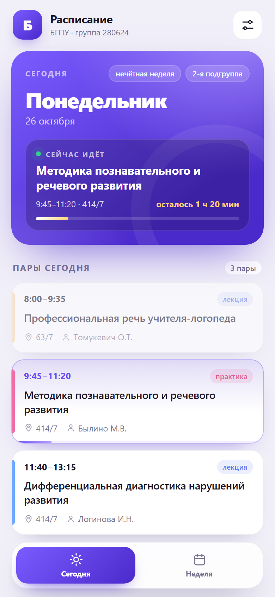

# Расписание БГПУ · группа 280624 — приложение в Telegram

Полноценный экран расписания внутри Telegram: сегодняшние пары, текущая пара
с обратным отсчётом, вся неделя, переключение подгруппы. Расписание берётся
с сайта БГПУ и обновляется автоматически — вручную данные править не нужно.



## Что умеет

- **Сегодня** — текущая пара с прогрессом и «осталось N мин», следующая пара,
  а после занятий — ближайший учебный день с его парами.
- **Неделя** — обе недели (эта / следующая), дни Пн–Сб, аудитории и преподаватели.
- **Подгруппа** — 1-я или 2-я, выбор запоминается на телефоне.
- **Автообновление** — GitHub раз в 3 часа проверяет сайт БГПУ и обновляет данные.
- **Офлайн** — последняя загруженная версия хранится на телефоне.

## Что понадобится

- Аккаунт **GitHub** — бесплатно. Нужен только для хостинга и автообновления.
- **Telegram** и 20–30 минут времени.

Сервер, домен и оплата не нужны: всё работает на бесплатных GitHub Pages
и GitHub Actions.

---

## Часть 1. Выложить приложение на GitHub Pages

### 1.1. Репозиторий

1. Зарегистрируйтесь на [github.com](https://github.com) (если аккаунта нет).
2. Нажмите **New repository**.
3. Имя: `raspisanie-bspu`. Тип: **Public** (для бесплатных Pages нужен публичный
   репозиторий). Галочки README / .gitignore не ставьте.
4. **Create repository**.

### 1.2. Загрузить файлы

На странице пустого репозитория: **Add file → Upload files**.

Перетащите **содержимое** папки `telegram` (не саму папку):

```
index.html
styles.css
app.js
schedule.json
icon.png
tools/            ← папка с build_schedule.py
```

Нажмите **Commit changes**.

### 1.3. Файл автообновления (папка .github)

Проверьте, появилась ли в репозитории папка `.github/workflows/`. Проводник
Windows скрывает папки с точкой, поэтому надёжнее создать файл вручную:

1. **Add file → Create new file**.
2. В поле имени вставьте целиком:
   `.github/workflows/update-schedule.yml`
3. Вставьте содержимое файла `telegram/.github/workflows/update-schedule.yml`
   из проекта.
4. **Commit changes**.

Именно этот файл раз в 3 часа обновляет расписание.

### 1.4. Включить Pages

1. **Settings → Pages**.
2. **Source**: *Deploy from a branch*.
3. **Branch**: `main`, папка **/ (root)** → **Save**.
4. Через 1–2 минуты на этой же странице появится ссылка вида
   `https://ВАШ_ЛОГИН.github.io/raspisanie-bspu/`.

Откройте её — должно открыться приложение с расписанием. Если 404 — подождите
ещё минуту и обновите страницу.

### 1.5. Первый запуск обновления

1. Вкладка **Actions** в репозитории.
2. Слева **«Обновление расписания»** → **Run workflow** → **Run workflow**.
3. Через полминуты появится зелёная галочка, а в репозитории — обновлённый
   `schedule.json`.

Дальше всё происходит само каждые 3 часа.

---

## Часть 2. Бот и Mini App в Telegram

1. Откройте **@BotFather** → `/newbot`.
2. Придумайте имя (например, «Расписание БГПУ») и username, заканчивающийся
   на `bot` (например, `bspu280624_bot`).
3. Отправьте `/newapp` → выберите созданного бота.
4. BotFather спросит по очереди:
   - **Title** — «Расписание»;
   - **Description** — «Расписание группы 280624 БГПУ»;
   - **Photo** — можно загрузить `icon.png` из папки `telegram`;
   - **Web App URL** — ссылка из шага 1.4
     (`https://ВАШ_ЛОГИН.github.io/raspisanie-bspu/`);
   - **Short name** — латиницей, например `schedule`.
5. В ответ BotFather пришлёт ссылку
   `https://t.me/ваш_бот/schedule` — это и есть приложение.

Дополнительно (по желанию):

- `/setmenubutton` → бот → та же ссылка → текст кнопки «Расписание» —
  тогда приложение открывается кнопкой внизу чата.
- `/setuserpic` — аватарка бота (`icon.png`).
- `/setdescription` — описание бота.

Отправьте ссылку девушке. Чат с ботом можно закрепить — приложение будет
открываться в один тап.

---

## Как пользоваться

- Внизу — два экрана: **Сегодня** и **Неделя**.
- Шестерёнка справа сверху — настройки: подгруппа, состояние данных,
  кнопка «Обновить».
- На экране «Неделя» переключатель **Эта неделя / Следующая**.
- Прошедшие пары приглушены, текущая подсвечена и показывает, сколько осталось.

## Подгруппа

По умолчанию выбрана **2-я** подгруппа. Переключить: шестерёнка → «1-я» / «2-я».
Выбор сохраняется на телефоне.

## Как обновляется расписание

1. GitHub Actions раз в 3 часа скачивает страницы с `ttable.bspu.by`,
   разбирает их и обновляет `schedule.json`.
2. Если что-то изменилось, файл коммитится в репозиторий.
3. GitHub Pages отдаёт новую версию.
4. Приложение при каждом открытии загружает свежий `schedule.json` и кэширует
   его на телефоне.

Если пары поменяли только что, а в приложении ещё старое: шестерёнка →
**Обновить** (данные на сервере обновятся максимум через 3 часа, либо запустите
workflow вручную во вкладке Actions).

Если данные не обновлялись больше 3 дней, над расписанием появится жёлтая
плашка с кнопкой «Обновить».

## Настройки в коде

Менять ничего не нужно. Но если расписание понадобится для другой группы:

- в `tools/build_schedule.py` — `GROUP_ID` (id группы на сайте) и `GROUP_NAME`;
- в `index.html` — подпись «группа 280624» в шапке;
- запустить `python tools/build_schedule.py`, закоммитить `schedule.json`.

## Если что-то не работает

| Симптом | Что делать |
| --- | --- |
| Страница 404 | Подождите 1–2 минуты после включения Pages, обновите. Проверьте, что `index.html` лежит в корне репозитория. |
| Пустой экран / «Нет связи» | Проверьте интернет. Откройте ссылку Pages в браузере — если и там ошибка, смотрите вкладку Actions. |
| Данные давно не менялись | Actions → «Обновление расписания» → Run workflow. Если запуск падает — сайт БГПУ изменил вёрстку, нужно поправить `parse_page` в `tools/build_schedule.py`. |
| В расписании не те пары | Проверьте подгруппу в настройках. |
| Mini App не открывается из Telegram | Web App URL должен быть `https://…` (GitHub Pages даёт https). Проверьте ссылку в BotFather через `/mybots` → бот → Bot Settings → Menu Button. |

## Локальный запуск

```bash
cd telegram
python tools/build_schedule.py     # обновить schedule.json с сайта
python -m http.server 8000         # открыть http://localhost:8000
```

Скрипт использует только стандартную библиотеку Python 3.10+.

## Структура

```
index.html                     экран приложения
styles.css                     оформление
app.js                         логика: сегодня/неделя, подгруппы, кэш
schedule.json                  расписание (обновляется автоматически)
icon.png                       аватарка для BotFather
tools/build_schedule.py        парсер сайта БГПУ → schedule.json
.github/workflows/
  update-schedule.yml          автообновление каждые 3 часа
```

## Ограничения

- Это не отдельное приложение, а Mini App: работает внутри Telegram и не шлёт
  push-уведомления.
- Данные обновляются раз в 3 часа (плюс кнопка «Обновить»), а не мгновенно.
- Источник — публичная страница БГПУ. Если сайт поменяет вёрстку, автообновление
  перестанет работать, но приложение продолжит показывать последнюю версию
  и предупредит об устаревании.
- GitHub Actions на бесплатном плане может запускаться с задержкой в несколько
  минут — на расписании это не сказывается.
